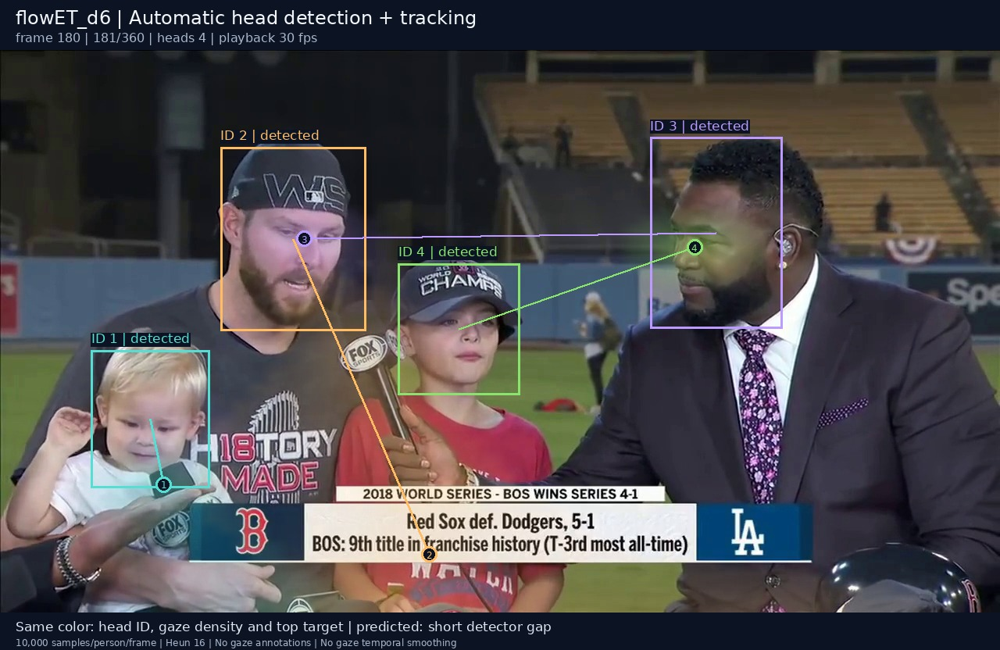
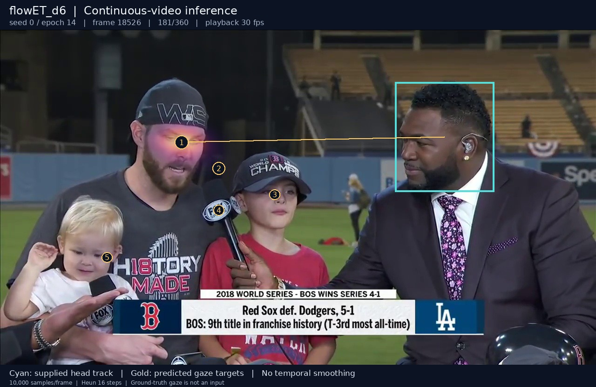

# Learning Gaze Distributions with Conditional Flow Matching

Private research release for the paper **Learning Gaze Distributions with Conditional Flow Matching**.

The released model, **flowET_d6**, combines a frozen DINOv2 ViT-L/14 backbone, scene and local head-region tokens, and a six-layer conditional flow decoder. It predicts a spatial gaze distribution and five weighted target hypotheses.

## Checkpoint and continuous-video demos

| Artifact | Download |
| --- | --- |
| Paper checkpoint: seed 0, epoch 14 | [flowET_d6_s0_epoch14.pt](https://github.com/Bellakira7/gaze-flow-matching/releases/download/v1.0.0/flowET_d6_s0_epoch14.pt) — 38,779,814 bytes |
| Original supplied-box predictions | [Demo MP4](assets/flowET_d6_continuous_demo.mp4) · [Release download](https://github.com/Bellakira7/gaze-flow-matching/releases/download/v1.0.0/flowET_d6_continuous_demo.mp4) |
| Input video | [source_continuous.mp4](https://github.com/Bellakira7/gaze-flow-matching/releases/download/v1.0.0/source_continuous.mp4) |
| Optional legacy input head track | [head_boxes.csv](assets/head_boxes.csv) |

**New: video-only automatic detection and tracking.**

[](assets/auto_head_demo.mp4)

[Automatic demo MP4](assets/auto_head_demo.mp4) · [v1.1.0 release](https://github.com/Bellakira7/gaze-flow-matching/releases/tag/v1.1.0). The new demo uses the same checkpoint and continuous source video, detects faces with the bundled YuNet model, expands them into head boxes, and tracks multiple people. Matching colors link each local track ID, its gaze density, and its highest-weight gaze target. Detection misses can briefly use a box labeled `predicted`. The automatic run uses 10,000 samples per person per frame; validation details are in [experiments/AUTO-HEAD-20261127.md](experiments/AUTO-HEAD-20261127.md).

The original supplied-box demo is retained below for reference.

[](assets/flowET_d6_continuous_demo.mp4)

The demo contains **360 consecutive frames**, played at **30 fps for 12 seconds**, from the VideoAttentionTarget MLB Interview clip. Every frame was independently processed with the released checkpoint. The cyan box identifies the right-hand interviewer; the heatmap and gold targets are model predictions. Head boxes come from the dataset's person track. Ground-truth gaze is not supplied, and there is no temporal smoothing. Playback frame rate is not inference speed. The source dataset provides extracted frames, so the demo has no audio.

This is the fixed seed-0 main model used by the paper. The `.pt` file contains the trainable trunk and flow decoder. The frozen **DINOv2 ViT-L/14 weights are separate** and loaded from an official download/cache or an explicitly supplied file.

Checkpoint SHA-256:

```text
200072de520ca356e69591121a63e3ef4979b046b08d4166fe3564a5e4503657
```

Downloads require access to this private repository. Sign in to GitHub and download the release assets, or use an authenticated GitHub CLI:

```bash
gh release download v1.0.0 --repo Bellakira7/gaze-flow-matching \
  --pattern flowET_d6_s0_epoch14.pt --dir checkpoints
gh release download v1.0.0 --repo Bellakira7/gaze-flow-matching \
  --pattern source_continuous.mp4 --dir assets
```

## Installation

Use Python 3.10 or newer, a CUDA-compatible GPU, and FFmpeg 5 or newer (`ffmpeg`/`ffprobe` on PATH). Install the PyTorch/torchvision build suitable for your accelerator, then install the remaining dependencies:

```bash
git clone https://github.com/Bellakira7/gaze-flow-matching.git
cd gaze-flow-matching
python -m pip install -r requirements.txt
```

Gaze-LLE and DINOv2 Python sources are vendored at the revisions recorded in [THIRD_PARTY_NOTICES.md](THIRD_PARTY_NOTICES.md). No extra source-code clone is required. `xformers` is optional; DINOv2 supports its standard PyTorch attention path.

The original continuous demo used torch 2.9.0, torchvision 0.24.0, numpy 1.26.4, scipy 1.17.1, timm 1.0.27, and a PPU-ZW810E accelerator with its CUDA-compatible vendor runtime. The release's portability check and its exact scope are recorded in [provenance/validation.json](provenance/validation.json).

## Run on any video

After the one-time dependency and checkpoint setup above, **only the video is required**:

```bash
python demo.py --video /path/to/video.mp4
```

The bundled 233 KB YuNet detector needs no separate download. The default processes all detected people. To follow one person, select the rightmost person in the first frame containing detections (the ID stays locked within the shot):

```bash
python demo.py --video assets/source_continuous.mp4 --target rightmost --out output/interviewer
```

Other selectors are `--target leftmost`, `--target largest`, or an explicit ID such as `--target 3`. IDs are assigned left-to-right when tracks first appear, persist through short gaps, and are never recycled within a run. Numeric IDs refer only to this video's tracks. Spatial selectors reselect after a detected scene cut; numeric selectors stay locked. A lost target is not automatically replaced with a different track. Geometry-based tracking can still confuse people during crossings.

On an offline machine, add `--backbone-weights /path/to/dinov2_vitl14_pretrain.pth`. For research scripts, set the equivalent environment variable `DINOV2_WEIGHTS`.

The output defaults to `output/<video stem>_<timestamp>/` and includes:

- `demo.mp4`: all decoded frames, with colored head IDs, gaze densities and top targets. A frame with no selected head is retained and explicitly labeled; gaze inference is skipped.
- `head_tracks.csv`: normalized tracked boxes, ID, `detected`/`predicted`/`supplied` source, last detection score, missed-frame count and selection flag. A detected box is Kalman-filtered; a predicted box is a short extrapolation, not a current detection.
- `predictions/000000.npz`, etc.: one file per frame; `track_ids [P]`, `boxes [P,4]`, `samples [P,N,2]`, `hyps [P,5,2]`, `w [P,5]`, and zero-based `frame`. `P` can change or be zero. Arrays stream to disk rather than accumulating the whole video in RAM. This replaces the original single `predictions.npz` layout.
- `frames.json`, previews and `stats.json`: frame/track counts, scene resets, input/checkpoint/detector hashes, settings and measured runtime.

The default sampler uses 10,000 points **per person per frame**, Heun integration with 16 steps and gamma 3, followed by five-hypothesis extraction with sigma_h 1. The video displays the highest-weight hypothesis per person; all five are saved. The same random seed is reset for each person/frame to reduce Monte Carlo flicker; gaze predictions are not temporally smoothed. Head geometry is filtered by the tracker. Multi-person videos take more compute than a single-person run.

For a quick smoke check, add `--limit 2`. To reduce sampling cost, try `--samples 1024` (this changes the sampling preset). Detector settings include `--det-threshold 0.8`, `--det-size 960`, `--min-face-size 24`, and `--max-heads 8` (caps retained detections, not all temporarily retained tracks). Tracking defaults allow two predicted frames and keep unmatched IDs eligible for reassociation for up to 15 missed frames; tune with `--track-predict-gap` and `--track-max-age`.

### What the automatic head boxes mean

YuNet detects **visible faces**, which are expanded by 1.5 in width and height and shifted up by 0.1 face height. It is not a whole-head detector trained for back-of-head views. Profile views, occlusion, small faces, fast motion, and cuts can cause misses or ID changes. Geometry-based Kalman/Hungarian association does not identify people or guarantee IDs through crossings. Scene-cut detection is a heuristic. These boxes differ from the paper's annotated evaluation boxes, so this demo is not a new benchmark result. There is no out-of-frame gaze classifier.

The output preserves one frame per decoded input frame, uses the input's average frame rate, and omits audio. Variable-rate inputs are retimed to that constant rate. Playback fps is not inference speed. The downloadable source is a lossy MP4 of dataset JPEG frames, so results may differ slightly from the original supplied-box demo that used those JPEGs directly.

### Optional supplied-box mode

The previous input remains supported:

```bash
python demo.py --video assets/source_continuous.mp4 \
  --head-boxes assets/head_boxes.csv --out output/supplied
```

Supply exactly one normalized box per video frame, with zero-based consecutive frame indices:

```csv
frame,xmin,ymin,xmax,ymax
0,0.6734375,0.1583333,0.8398438,0.4861111
1,0.6734375,0.1583333,0.8398438,0.4861111
```

This bypasses automatic detection/tracking and follows one supplied person. The generated multi-track `head_tracks.csv` is an audit output, not this legacy input format.

## Research code

| Directory | Contents |
| --- | --- |
| `gazelle_online/` | Flow/MDN/MCL models, local-token and ray variants, training, inference, sampler selection, ablations, forecast experiments, and paper table generation |
| `gazelle_cached/` | Backbone loading, cached-feature extraction, and heatmap baseline utilities |
| `setmetrics/` | Set-aware metrics, prediction bundles, and G2 evaluation/gating |
| `tools/` | Dataset conversion and shared scoring utilities used by the VAT comparisons; some retain legacy Gaze-R1 entry points |
| `configs/` | Main-model training arguments and frozen sampler selection |
| `prereg/` | Original G1/S1/G2 protocol documents and later clarifications |
| `results/paper/` | Archived paper tables and latency results |
| `provenance/` | Original code hashes, release validation, and demonstration metadata |

See [docs/REPRODUCTION.md](docs/REPRODUCTION.md) for training and evaluation inputs. Dataset images, training checkpoints for other arms, and the large prediction archives are not bundled. Full benchmark reconstruction requires those datasets and intermediate artifacts; the release assets are sufficient for the continuous-video demo.

The original flow formulation and the later eye-token/depth variants are retained separately. The paper's selected six-layer method was developed after earlier test feedback; repeated seeds characterize that selected architecture. The archived protocol documents and tables retain this distinction.

## Source and licenses

Project paths were made relative to the repository; offline backbone weights are configurable. Original research source hashes and upstream revisions are in [provenance/source_manifest.json](provenance/source_manifest.json). Numerical model and metric implementations are retained from the research code.

See [THIRD_PARTY_NOTICES.md](THIRD_PARTY_NOTICES.md) and the bundled upstream licenses. This is a private research release; no additional license is granted for the project-specific code, checkpoint, or underlying video.
